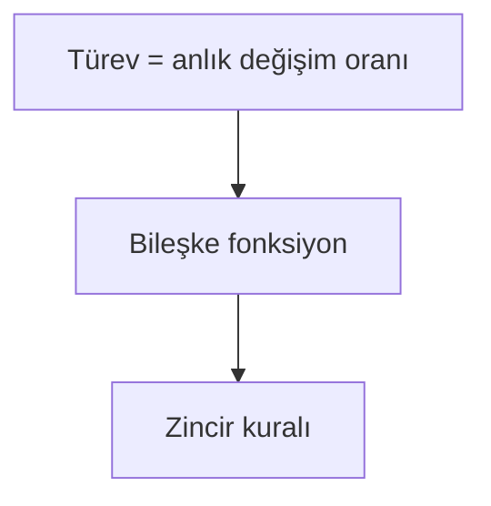

# Öğrenme verisi biçimi

Tüm dosyalar düz metin; elle okunabilir ve git ile takip edilebilir.

## `ogrenme/profil.md`

Serbest Markdown. Örnek başlıklar: `## Dil ve üslup`, `## Tempo`, `## Tercih edilen anlatım`
(Sokratik / ekspozitif), `## Tekrarlayan yanılgılar`, `## Aktif hedefler`. Tarih vererek güncelle.

## `ogrenme/oturumlar/<YYYY-MM-DD>-<slug>.md`

```markdown
---
baslik: Zincir kuralının sezgisi
tur: ogretim            # ogretim | pratik
tarih: 2026-11-09
durum: acik             # acik | tamamlandi
hedef: "Zincir kuralının neden çarpım olduğunu apaçık görmek"
---

## Ölçüm
| Dal | Taban (bildiği) | Tavan (bilmediği) | Yanılgılar | Buradan inşa et |
| --- | --- | --- | --- | --- |

## Plan
(yaklaşım paragrafı)

Revizyonlar: `- 2026-11-09 14:20 — eksik temel eklendi: limit sezgisi (çünkü …)`

## Soru kaydı
| # | Düğüm | Tür | Soru (kısa) | Cevabı | Güven | Düşüncesi | Sonuç |
| --- | --- | --- | --- | --- | --- | --- | --- |
| 1 | turev-tanimi | kontrol | … | B | %80 | "…" | doğru |

## Yanılgılar ve onarımlar
## Açık kalanlar / sonraki oturum
```

Kurallar: kullanıcının cevabını ve düşüncesini **kendi kelimeleriyle** kaydet; uydurma; cevapsız soru
"cevapsız" olarak kalır. Puanlama mekanik doğru/yanlış ise "doğru/yanlış", serbest cevapsa
"kısmi: … tuttu, … kaçırdı".

## `ogrenme/grafik/onermeler.jsonl`

Her satır bir önerme (düğüm):

```json
{"id": "n-zincir-kurali", "ad": "Zincir kuralı", "onerme": "f(g(x))'in türevi f'(g(x))·g'(x)'tir.", "takma_adlar": ["chain rule"], "konu": "kalkulus", "temel": false, "kaynak": [{"oturum": "2026-11-09-zincir-kurali", "tarih": "2026-11-09"}]}
```

- `id`: `n-` + küçük harf-rakam-tire; kalıcı. Aynı önerme tekrar geçerse yeni satır ekleme, mevcut
  satırın `kaynak` listesine ekle (dosyayı yeniden yaz).
- `temel: true` = koşulsuz doğru olarak verilmiş kök.
- Önerme tek, kendi başına anlaşılır bir iddiadır; "ve" ile iki iddiayı birleştirme.

## `ogrenme/grafik/zincirler.jsonl`

Öncüller **birlikte** sonucu gerektirir:

```json
{"id": "c-zincir-carpim", "onculler": ["n-turev-oran", "n-oranlar-carpilir"], "sonuc": "n-zincir-kurali", "adim": "Her katman değişimi kendi oranıyla büyütür; ardışık büyütmeler çarpılır.", "kaynak": [{"oturum": "2026-11-09-zincir-kurali"}]}
```

## Yorumlama uyarıları

- Grafik bir **alan haritasıdır**, ustalık puanı değil. Kanıt için oturum kayıtlarındaki cevaplara bak.
- Grafikte olmaması bilmediği anlamına gelmez.
- Öğretmenin yazdığı metin ve grafik de modelce yazılmıştır ve yanlış olabilir.
